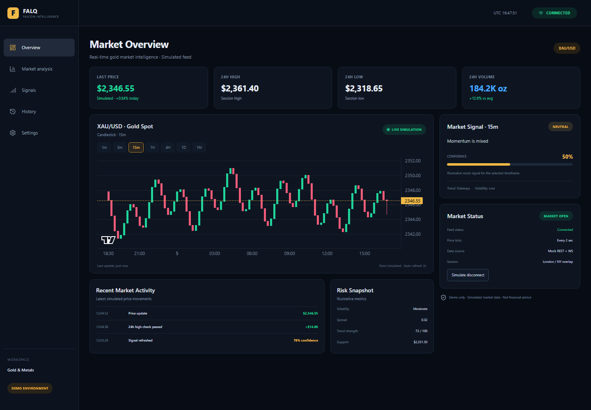

# FALQ — Falcon Intelligence

**XAU/USD market intelligence dashboard demo** built with React, TypeScript, Vite, Tailwind CSS, and TradingView Lightweight Charts.



> All prices, candles, signals, and connection states are simulated. This demo does not connect to a real market, backend, or AI service and is not investment advice.

**Live demo:** [falq-dashboard.vercel.app](https://falq-dashboard.vercel.app)

## Features

- Candlestick chart with `1m`, `5m`, `15m`, `1H`, `4H`, `1D`, and calendar-month `1M` intervals.
- Simulated price feed with automatic recovery and a manual disconnect/reconnect control.
- Market summary and illustrative signal derived from the selected timeframe's candles.
- Responsive dashboard layout with explicit connection and data-source status.

## Requirements

- Node.js `^20.19.0` or `>=22.12.0` (Vite 8 requirement); `.nvmrc` selects Node 22.
- npm

## Setup and commands

```bash
git clone https://github.com/Abdelrahman0000/falq-dashboard.git
cd falq-dashboard
npm install
npm run dev
```

| Command | Purpose |
| --- | --- |
| `npm run dev` | Start the local Vite development server. |
| `npm run build` | Type-check and create the production build in `dist/`. |
| `npm run preview` | Serve the production build locally after building. |
| `npm test` | Run the Vitest suite once. |
| `npm run lint` | Run Oxlint. |

## Project structure

```text
src/
├── app/                         # Application entry composition
├── assets/                      # Static assets imported by the UI
├── components/
│   ├── charts/                  # Lightweight Charts adapter and lifecycle
│   └── layout/                  # Shared dashboard shell and header
├── data/                        # Deterministic mock market data and tests
├── features/market/
│   ├── components/              # Market dashboard presentation components
│   ├── data/                    # Market constants and signal derivation
│   └── hooks/                   # Market feature state orchestration
├── hooks/                       # Reusable feed and clock hooks
├── lib/                         # Shared formatting helpers
├── services/                    # Mock snapshot API and market-feed adapter
├── styles/                      # Design tokens, layout, and responsive styles
└── types.ts                     # Shared market and connection types
```

## Architecture decisions

- **Chart wrapper:** `MarketChart` owns the Lightweight Charts instance, resize handling, and series lifecycle; the rest of the UI works with typed candle data instead of chart-library APIs.
- **Feed contract:** `MarketFeed` separates subscription and connection controls from the UI. `simulatedMarketFeed` implements it now and can be replaced by an adapter for a real transport without changing dashboard components.
- **Incremental chart updates:** `setData()` loads initial history and a newly selected timeframe. Incoming ticks and newly formed candles use `series.update()` to avoid resetting the full series and viewport.
- **Connection lifecycle:** one shared simulated feed owns its interval and recovery timers. It pauses ticks while reconnecting or disconnected, supports a manual disconnect, and clears timers when its last subscriber unsubscribes (including React StrictMode cleanup).
- **Mock data boundaries:** candle generation uses UTC-aligned intervals and calendar boundaries for `1M`; all market data stays local to the frontend demo.
- **Feature separation:** hooks coordinate state and services; components render props; formatting and signal calculations live outside presentation components.

## Validation

```bash
npm run lint
npm test
npm run build
```

## Repository metadata

Suggested GitHub description: **Responsive XAU/USD market dashboard demo built with React, TypeScript, Vite, Tailwind CSS, and TradingView Lightweight Charts.**

Suggested topics: `react`, `typescript`, `vite`, `tailwindcss`, `lightweight-charts`.
